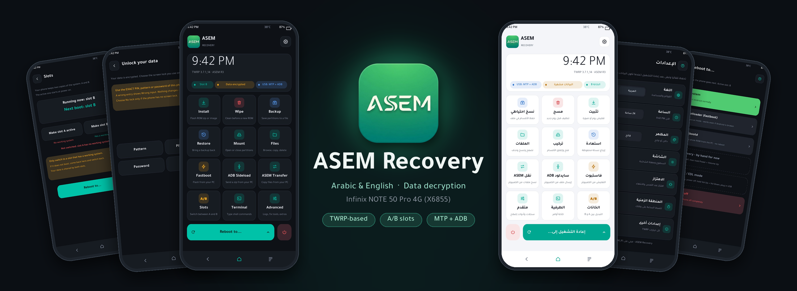

<b>بسم الله الرحمن الرحيم</b> 
<i>In the name of Allah, the Most Gracious, the Most Merciful</i>

# ASEM Recovery - Infinix NOTE 50 Pro 4G (X6855)

## ريكفري ASEM — دعم عربي أصيل

**ASEM Recovery** من أوائل أنظمة الريكفري المبنية على **TWRP** التي صُمّمت منذ البداية لتدعم
**اللغة العربية دعمًا كاملًا وأصيلًا**، وليس مجرد ترجمة للنصوص:

- **حروف عربية موصولة بشكل صحيح** — يُعاد تشكيل الكلمات عند بناء الريكفري، لأن محرك العرض
  في TWRP لا يصل الحروف العربية بنفسه.
- **واجهة كاملة من اليمين إلى اليسار** — تنعكس الصفحات والأزرار والبطاقات تلقائيًا عند اختيار العربية.
- **خط عربي واضح وأنيق** (Tajawal) مصمم للشاشات، مع دعم مزج العربية والإنجليزية في السطر الواحد.
- **شرح لكل خيار باللغة العربية** — كل زر وكل صفحة مرفقة بتوضيح مبسط ليعرف المستخدم ما يفعله قبل تنفيذه.
- **وضع داكن وفاتح**، وساعة بنظام 12 أو 24 ساعة.

صُمّم ريكفري ASEM ليكون أداة احترافية وآمنة لمستخدمي هواتف **Infinix NOTE 50 Pro** في العالم
العربي، مع خطة ليصبح لاحقًا ريكفري شاملًا لأجهزة أخرى.

---

| | |
|---|---|
| Phone | Infinix NOTE 50 Pro 4G, X6855, MT6789, UFS, A/B + Virtual A/B |
| Firmware it is made for | XOS 16.3.0.155SP15, **Android 16**, kernel 6.12.38 GKI |
| Recovery base | TWRP android-14.1 (newest TWRP; Android 15/16 MTK devices use it) |
| Where it lives | the "recovery" ramdisk fragment inside `vendor_boot` |

## How it is built (and why it is safe for normal boot)

On this phone Transsion put the whole generic ramdisk (first-stage `init`, stock
recovery, adbd, fastbootd, the MTK boot-control HAL) into the **platform** ramdisk
of `vendor_boot`, and `init_boot` is empty. Normal boot uses only that platform
ramdisk; recovery mode loads platform + "recovery" fragment.

So ASEM Recovery does NOT rebuild vendor_boot. `build.sh` builds TWRP, takes only
its recovery ramdisk, and `tools/asem_vendor_boot.py` puts it into the **stock**
vendor_boot (`stock/`). The platform ramdisk, DTB, bootconfig and header stay
byte-identical (round-trip test: rebuilding stock gives a byte-identical image).

The stock image has an AVB hash footer; ours has none. With the unlocked
bootloader (state "orange") this is accepted, same as the Magisk-patched boot.

## The ASEM theme (theme/)

Built in from the first build (no plain-TWRP stage):

- `theme/apply_theme.py` - applies the theme to the synced TWRP tree; `--check`
  validates every XML file, image, font, page link and string before compiling.
- `theme/tools/make_images.py` - draws all theme images (dark `_d` / light `_l`)
  from `tools/icon_sheet.png` (rendered from `tools/icons.html`) and the logo.
- `theme/tools/arabic.py` - joins Arabic letters and orders text right-to-left
  (TWRP cannot do this itself). Font: Tajawal (OFL), English + Arabic.
- `theme/tools/preview.py` - draws the generated pages on a PC at 1080x2337;
  results in `design/build_preview/`.
- Light theme: `ui_light.xml` + a 2-line patch in gui/pages.cpp and gui/gui.cpp.
- `TW_NO_REBOOT_RECOVERY := true`: no software reboot-to-recovery anywhere.

Licence: TWRP is GPLv3. 

## Build

Linux x86_64, ~60-80 GB free, `repo`, Python 3, the usual AOSP build packages.

    ./build.sh                      # -> out/ASEM_Recovery_X6855_ASEM_R1.img
    ASEM_DECRYPT=true ./build.sh    # R3 experiment

## Flash (only when you are ready - it replaces the recovery on that slot)

in bootloader fastboot:

    fastboot flash vendor_boot_b ASEM_Recovery_X6855_ASEM_R1.img     (active slot)

Bootloader fastboot does not depend on
vendor_boot, so this is always reachable (Power + Volume Down).
Enter recovery by hand: power off, hold Power + Volume Up.

## Android 16 notes

- `PLATFORM_VERSION 99.87.36` / `PLATFORM_SECURITY_PATCH 2099-12-31`: lets the
  Android 16 KeyMint accept the recovery (needed for decryption). Same as the
  Android 16 MediaTek TWRP trees with working decryption.
- Kernel modules are the stock Android 16 ones (loaded from the kept platform ramdisk).

  **fastbootd** (ASEM Recovery > Advanced > Fastboot) - that path is version-independent.

## R1 test checklist (fill in on the phone)

**Test safety rules (so no data is lost):** while testing, do NOT use "Mount system as
read/write" (erofs cannot be written; may show errors), do NOT Format Data, do NOT wipe
anything. 
Mounting / unmounting partitions is safe. 

| Feature | Result |
|---|---|
| Boots to ASEM Recovery | |
| Normal boot still works after flashing | |
| Touch | |
| Display / brightness | |
| ADB (`adb devices` shows recovery) | |
| MTP (phone visible on PC) | |
| Fastbootd (`fastboot devices` in userspace) | |
| Flash image from file picker | |
| Mount / unmount system, vendor, data | |
| A/B slot switch (stock MTK boot HAL) | |
| Wipe cache / dalvik / data | |
| Backup boot / vendor_boot / nvram | |
| Reboot to: System / Bootloader / Fastbootd / Power off | |
| Reboot to: Recovery - DISABLED in the UI (shown as instructions: power off, hold Power + Volume Up). | |
| USB OTG | |
| Decryption (R3) you must enter your phone pass or pin or pattern for it to work | |

## Long-term goal: universal ASEM Recovery

ASEM Recovery is meant to become universal (other phones). Rule for all work: keep the ASEM theme, texts, translations and
features device-independent; put everything phone-specific (partitions, offsets,
backlight path, slot HAL, BROM-vs-EDL card, which reboot targets are allowed)
in the device tree / a per-device config. X6855 is the first device.
  - Arabic: TWRP's text renderer does not join Arabic letters or do right-to-left
    by itself. Plan: ship a font with Arabic (e.g. Noto Sans Arabic) and convert
    the Arabic language file to pre-joined letter forms in visual order with a
    small script at build time; the layout XML gets a mirrored RTL variant.
  - "ASEM Transfer": an MTP storage in RAM so the PC can copy a ROM even when
    /data is encrypted or wiped [The Ram as storage is NOT TESTED and experimental].
- R3 - decryption (in recovery).

---

## Downolad

To download [go here](https://github.com/Asemayyad/asem-recovery/releases)

## Credits

- **[TeamWin - TWRP](https://twrp.me)** - ASEM Recovery is built on TWRP (android-14.1,
  GPLv3). Thank you to the TWRP team and its contributors.
- **[minimal-manifest-twrp](https://github.com/minimal-manifest-twrp)** - the TWRP source manifest.
- **[phhusson - lptools](https://github.com/phhusson/vendor_lptools)** - dynamic partition tool (patched here to use the current slot).
- **[Tajawal](https://fonts.google.com/specimen/Tajawal)** font (SIL Open Font License) - Arabic and English text.
- The Infinix X6855 / OrangeFox community device trees - used as reference.

**ASEM Recovery - created by Asem**

- Telegram: [@Asemfuad](https://t.me/Asemfuad)
- Instagram: [@asem.dev](https://instagram.com/asem.dev)
- To support me: [paypal@AsemAyyad](https://www.paypal.com/paypalme/Mus7af)

- To join our channel in Telegram [infinix_Note50Pro](https://t.me/infinix_note50pro)

## التحميل

لتحميل الريكوفري [اضغط هنا](https://github.com/Asemayyad/asem-recovery/releases)

## الشكر والتقدير

- **فريق TeamWin ومشروع [TWRP](https://twrp.me)** — ريكفري ASEM مبني على TWRP، فكل الشكر لفريقه
  وكل المساهمين فيه.
- مشاريع مفتوحة المصدر استُخدمت في البناء: minimal-manifest-twrp وأداة lptools وخط Tajawal.

**ريكفري ASEM — من تطوير عاصم (Asem)**

للتواصل:
- تيليجرام: [@Asemfuad](https://t.me/Asemfuad)
- إنستغرام: [@asem.dev](https://instagram.com/asem.dev)
- للدعم المادي: [paypal@AsemAyyad](https://www.paypal.com/paypalme/Mus7af)

- صفحتنا على تيلغرام [infinix_Note50Pro](https://t.me/infinix_note50pro)

